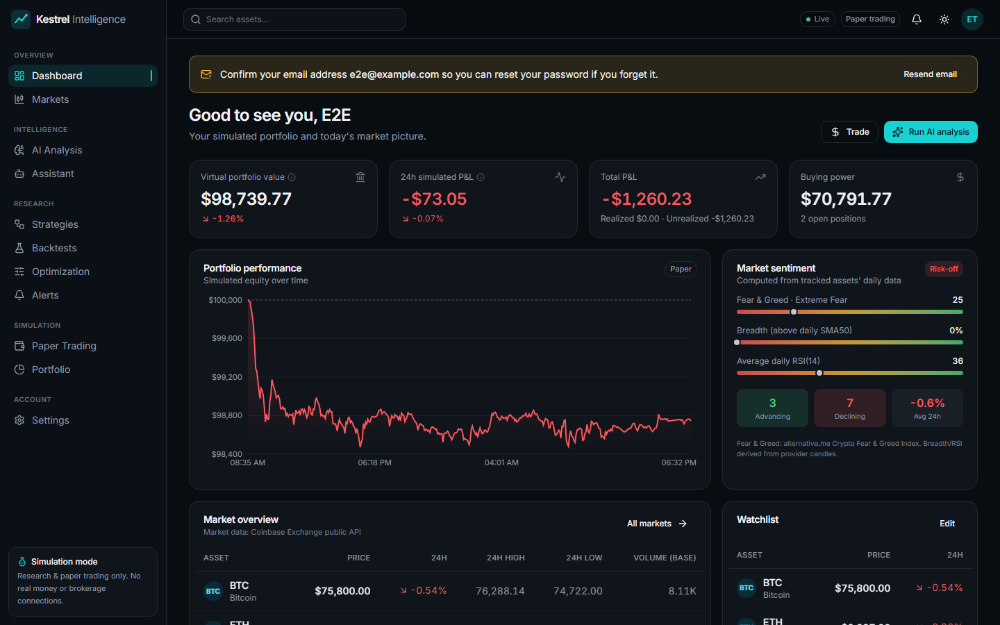
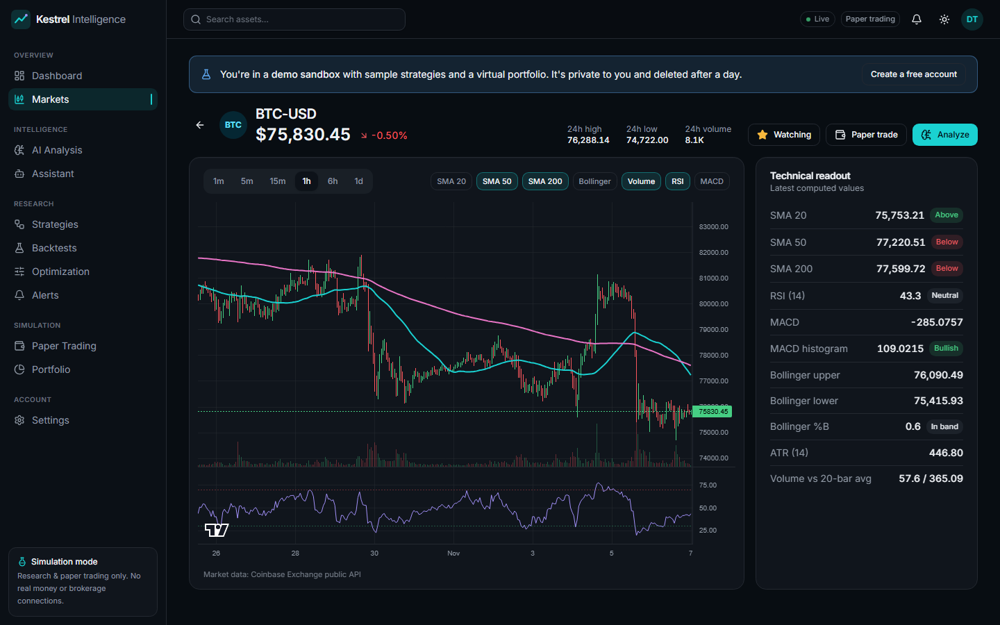
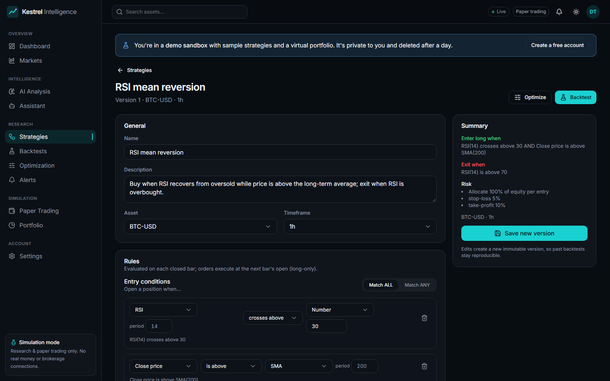
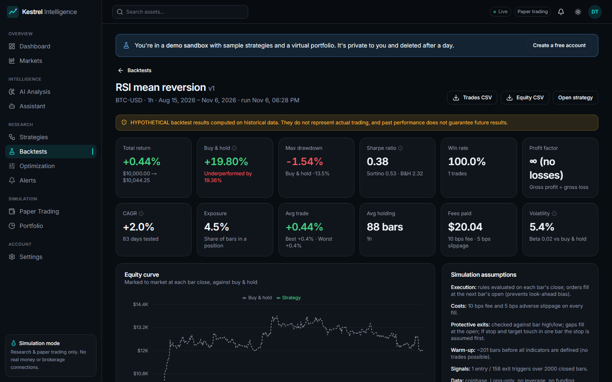
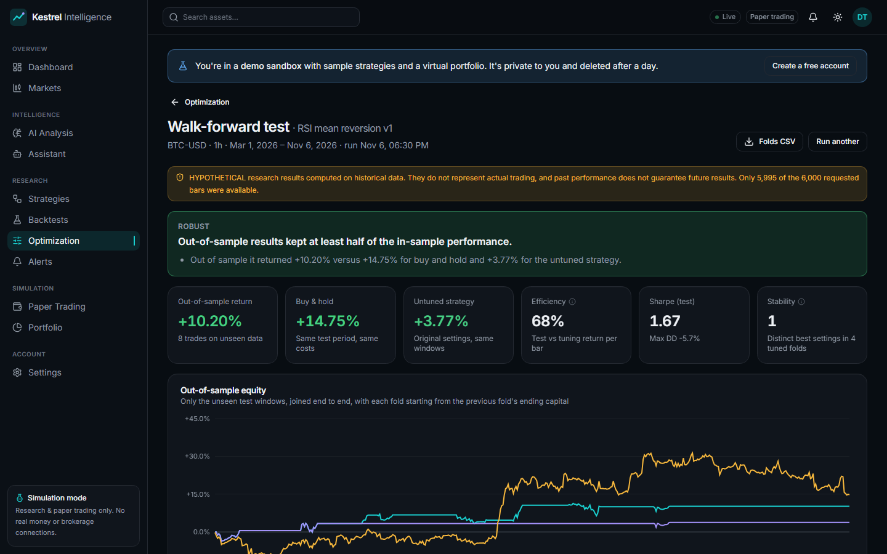
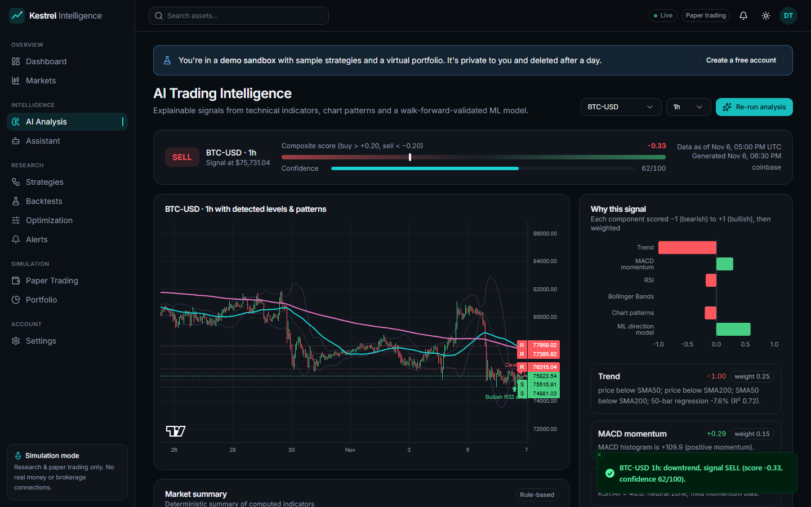
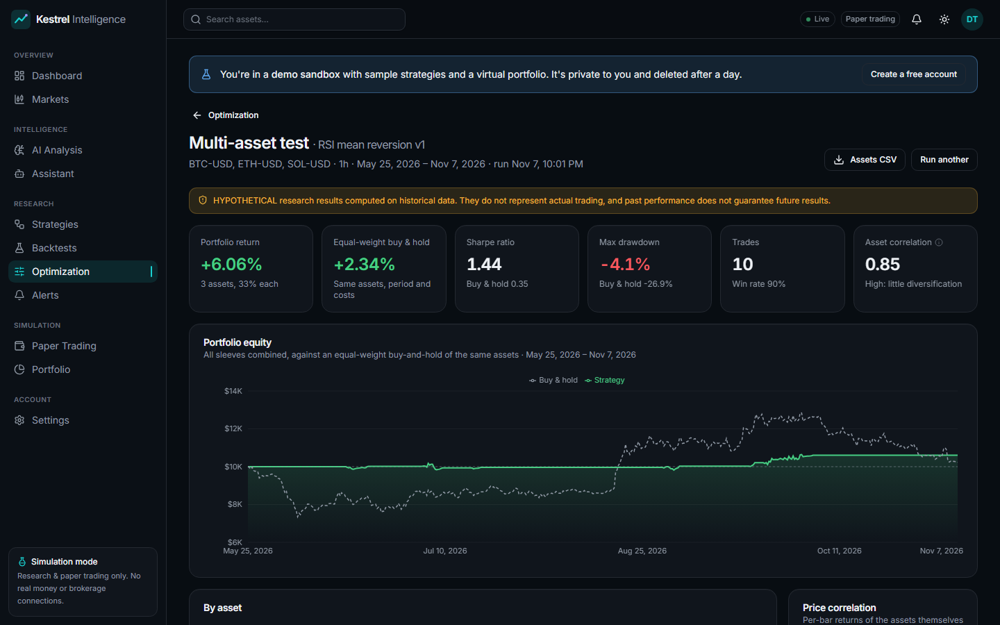

# Kestrel Intelligence — AI Trading Research Platform

An AI-assisted market research, backtesting and **paper-trading** platform for crypto markets, with an architecture ready for stocks and forex.

> **Simulation & research only.** There is no real-money trading, no brokerage connectivity and no financial transactions anywhere in this codebase. AI outputs are estimates derived from historical data, not predictions or financial advice.

| Area | What you get |
|---|---|
| Dashboard | Virtual portfolio value, 24h P&L, equity curve, live market table, watchlist, AI insight, recent signals and orders, market sentiment |
| Markets | Live prices streamed from Coinbase's public feed as trades happen (REST polling as fallback), catalog search to track new assets, candlestick charts (1m–1d), SMA 20/50/200, Bollinger Bands, volume, RSI, MACD |
| AI Analysis | Trend regression, support/resistance, pattern detection, a walk-forward ML model, an explainable composite signal with confidence, and a risk breakdown |
| Strategy Builder | Visual rule builder (13 indicators, 6 operators, ALL/ANY logic), risk exits, templates, immutable versioning |
| Backtesting | Long or short strategies (shorts use stops above entry and a margin call if price doubles); next-bar execution, fees, slippage, gap-aware stops; return, max drawdown, Sharpe/Sortino, a buy-and-hold benchmark with the same costs (overlaid on the equity curve, with excess return and beta), win rate, profit factor, CAGR, exposure; side-by-side comparison |
| Optimization | Multi-asset tests (one strategy on 2–6 coins with capital split equally, against an equal-weight buy-and-hold, with per-coin results and price correlation); parameter sweeps over 1–2 settings (heatmap of every combination, robustness stats) and walk-forward tests that tune on one window and score only on the next, unseen one, against the untuned strategy and buy-and-hold, with a rule-based verdict |
| Alerts | Notifications when a saved strategy's entry or exit rules fire on a newly closed live candle, checked every minute with the same rule engine as the backtester. Fires once when a rule becomes true, never replays history, and caps catch-up after downtime. Shown in the header and on an alerts page, with optional email to verified addresses and webhooks to Slack, Discord or any HTTPS endpoint (generic ones are HMAC-signed). Alerts alone place no orders |
| Forward testing | Optional auto paper-trading per strategy: it buys and sells in the paper portfolio on its own live signals, stops, targets and time limit, mirroring the backtester. It respects the portfolio's risk limits, only sells what it bought, and shows round trips and win rate next to the backtest. Short strategies short and cover when short selling is enabled; simulated only |
| Paper Trading | $100k virtual balance, market, limit, stop and trailing-stop orders, one-click stop-loss (fixed or trailing) and take-profit protection for a position (one cancels the other; it follows the position and never blocks closing it), optional short selling (proceeds held as collateral, margin call if price doubles) (orders that fill or fail in the background, and margin calls, appear in the notification bell and can also go to your webhook) (open limit orders reserve cash or quantity; exposure limits are re-checked at fill time), positions, realized/unrealized P&L, risk limits, order and trade history, reset |
| Portfolio | Equity and drawdown history, allocation, trade statistics |
| Assistant | Chat grounded in platform data through tool calls; reports missing data as unavailable |
| Admin | Role management, account disabling, audit log viewer |
| Operations | Prometheus metrics from the API and worker (latency per route, background jobs, live-feed health, simulated orders), an optional Prometheus service with alert rules, and a [runbook](docs/OPERATIONS.md) for backups, restores, upgrades and secret rotation |

---

## Screenshots

All screenshots show live Coinbase market data and a simulated portfolio.

| | |
|---|---|
|  |  |
| **Dashboard:** virtual portfolio, equity curve, market sentiment and live prices | **Markets:** candlesticks with overlays, RSI/MACD panes and a technical readout |
|  |  |
| **Strategy builder:** visual rules, long or short, risk exits, versions and alerts | **Backtest:** metrics, an equity curve against buy-and-hold, and drawdown |
|  |  |
| **Walk-forward test:** tuned on one window, scored only on the next unseen one | **AI analysis:** trend, patterns, an ML model and an explainable composite signal |
|  | |
| **Multi-asset test:** one strategy on several coins, against an equal-weight buy-and-hold, with price correlation | |

## Architecture

```
┌────────────────────────┐   /api/v1/* (same-origin proxy,     ┌───────────────────────────┐
│ Next.js 16 (React 19)  │──── httpOnly session cookie) ──────▶│ FastAPI (async)           │
│ Tailwind 4 · shadcn/ui │                                     │  ├─ market_data ─▶ Coinbase│
│ lightweight-charts     │◀──── ws /api/v1/ws/market ──────────│  ├─ indicators / ai        │
│ Recharts · React Query │        (live tickers)               │  ├─ strategies/backtesting │
└────────────────────────┘                                     │  ├─ paper_trading          │
                                                               │  └─ background jobs        │
                                                               └──────┬──────────────┬─────┘
                                                                PostgreSQL         Redis
                                                               (SQLAlchemy +   (cache, rate
                                                                 Alembic)        limiting)
```

### Repository layout

```
backend/
  app/
    api/            # FastAPI routers + dependencies (auth, RBAC, rate limits)
    core/           # config, logging, security, cache, exceptions
    database/       # engine/session, declarative base, portable column types
    models/         # SQLAlchemy models (21 tables)
    schemas/        # Pydantic request/response models
    market_data/    # provider interface, Coinbase + sample providers, caching service
    indicators/     # causal technical indicators
    ai/             # patterns, ML model, signal scoring, LLM narration, assistant
    strategies/     # rule DSL + evaluator + templates
    backtesting/    # engine + metrics
    paper_trading/  # order/fill/position ledger
    services/       # auth, audit, sentiment, background jobs
  alembic/          # migrations
  tests/            # pytest suite
frontend/
  src/
    app/            # routes (auth group, authenticated app group, API proxy)
    components/     # ui primitives (shadcn-style), layout, shared finance widgets
    features/       # dashboard, markets, charts, ai-analysis, strategies, backtesting,
                    # paper-trading, portfolio, assistant, settings, admin
    hooks/          # auth, theme, market WebSocket stream
    services/       # typed API client
    lib/ types/ styles/
docker-compose.yml
```

### Design decisions

- **Real data only.** Market data comes from the [Coinbase Exchange public API](https://docs.cdp.coinbase.com/exchange/) (no key needed). Sentiment combines breadth and RSI computed from that data with the [alternative.me Crypto Fear & Greed Index](https://alternative.me/crypto/fear-and-greed-index/). Every data widget shows its source. A synthetic `sample` provider exists for offline development. It is flagged `is_sample` end to end, shows a persistent warning banner, and its data is never persisted.
- **The LLM never generates numbers.** Indicators, patterns, ML estimates, signals and risks are all computed in Python. When `OPENAI_API_KEY` is set, the model only *phrases* those computed facts, under explicit grounding rules. The assistant reaches data only through tools that read real application state. Without a key, both features fall back to deterministic text and say so in the UI.
- **No look-ahead bias.** Indicators are causal (tested). Rules are evaluated at bar *t*'s close and filled at bar *t+1*'s open. Stops are gap-aware and resolved conservatively (stop before target in the same bar). Analysis uses closed candles only. The ML model uses a forward-chaining `TimeSeriesSplit` with a gap equal to its label horizon, and is compared against a naive baseline. It gets zero weight in the signal when it shows no out-of-sample edge, which is common.
- **Explainable signals.** Each signal is a weighted average of components scored −1…+1, each with a reason: trend, MACD, RSI, Bollinger, patterns and ML. Confidence blends score magnitude with agreement between components and is capped at 85/100.
- **Reproducible strategies.** Editing a strategy creates a new immutable configuration version. Each backtest references the exact version it ran.
- **Paper-trading accounting.** Buy fees are capitalized into cost basis, so `equity − starting balance = realized + unrealized P&L` exactly (tested).
- **Sessions, not JWTs in JS.** Login issues an opaque random token in an `httpOnly`, `SameSite=Lax` cookie. Only an HMAC of the token is stored, so sessions are revocable on logout or password change. The Next.js server proxies `/api/v1/*`, which keeps the cookie first-party.
- **PyTorch is intentionally not included.** The ML component is a regularized logistic regression (scikit-learn), chosen for explainability (per-feature log-odds contributions) and because a deep model on a few hundred bars would mostly overfit. `ai/ml_model.py` keeps a small interface (`predict_direction(df) → dict`), so a PyTorch model can be added without touching callers.

### Security

- Argon2id password hashing with rehash-on-login and timing-equalized failed logins (no user enumeration)
- Server-side sessions with revocation, RBAC (`user` / `admin`) and an audit log for auth, admin, orders and strategy events
- Per-IP rate limiting, backed by Redis or an in-memory fallback, with stricter auth and compute buckets
- Pydantic validation on every input; strategy DSL parameters are range-checked
- Centralized error handling returns structured JSON errors with request IDs and never leaks stack traces
- A strict Content-Security-Policy: each page request gets a fresh script nonce ([`src/proxy.ts`](frontend/src/proxy.ts)), so only the app's own scripts run and injected markup can't execute code. A browser flow checks this by injecting an XSS payload
- Other security headers on both tiers (`X-Frame-Options`, `nosniff`, Referrer-Policy, Cross-Origin-Opener-Policy, HSTS when `COOKIE_SECURE=true`) and a WebSocket origin check
- Alert webhooks are SSRF-safe: https only, every resolved address must be public (no loopback, private, link-local or cloud-metadata ranges), the connection is pinned to the checked address while TLS still verifies the hostname (no DNS rebinding), and redirects are never followed
- Dependency audits in CI (`pip-audit` on the pinned Python packages, `npm audit` on production packages) and weekly Dependabot updates for Python, npm, Docker images and GitHub Actions
- CORS allow-list, secrets read only from the environment, and `.env` git-ignored

---

## Running it

### Option A — Docker Compose (recommended)

Requirements: Docker with Compose v2.24+.

```bash
cp .env.example .env
# Set SECRET_KEY:  python -c "import secrets; print(secrets.token_urlsafe(48))"
# Optional: OPENAI_API_KEY, ADMIN_EMAILS=you@example.com
docker compose up --build
```

- App: <http://localhost:3000> (register an account; emails listed in `ADMIN_EMAILS` become admins once verified. With the default `EMAIL_BACKEND=console`, the verification link is printed in the backend log.)
- API docs: <http://localhost:8000/docs> · readiness: <http://localhost:8000/health/ready>

Migrations run automatically when the backend container starts.

### Deploying with HTTPS

[`docker-compose.prod.yml`](docker-compose.prod.yml) adds [Caddy](https://caddyserver.com) in front of the stack:

- Caddy gets and renews a Let's Encrypt certificate for your domain and redirects HTTP to HTTPS.
- Only ports 80 and 443 are published. The API, web server, PostgreSQL and Redis stay on the internal Docker network.
- The live price stream is routed to the API over `wss://`, and everything else to Next.js.
- Caddy replaces any client-sent `X-Forwarded-For` with the real client address. With `PROXY_SHARED_SECRET`, the API trusts it, so each visitor gets their own rate limit.
- The override switches on production mode, secure cookies, the right CORS/WebSocket origin and `https://` links in emails.

```bash
cp .env.example .env
# Required: SECRET_KEY and PROXY_SHARED_SECRET, each from: openssl rand -hex 32
# Recommended: EMAIL_BACKEND=smtp plus SMTP_* so verification and reset emails are delivered
# Point your domain's DNS A/AAAA record at this server, then:
DOMAIN=trading.example.com docker compose -f docker-compose.yml -f docker-compose.prod.yml up -d --build
```

To try it locally first, use `DOMAIN=localhost` and open <https://localhost>. Caddy then uses its own local certificate authority, so the browser shows a certificate warning. Production mode refuses to start with the example `SECRET_KEY` or any key shorter than 32 characters.

### Monitoring and backups

`docker compose --profile monitoring up -d` adds Prometheus on <http://127.0.0.1:9090>. It scrapes the API's `/metrics` and the worker's port 9100 and loads the alert rules in [`deploy/prometheus-alerts.yml`](deploy/prometheus-alerts.yml). [docs/OPERATIONS.md](docs/OPERATIONS.md) lists every metric, what to do when each alert fires, and how to back up, restore, upgrade, rotate secrets and scale.

### Option B — Local development (no Docker)

Requirements: Python 3.13+ (tested on 3.14) and Node.js 22+ (tested on 24). PostgreSQL and Redis are optional: the backend falls back to SQLite and an in-process cache.

**Backend**

```bash
cd backend
python -m venv .venv
# Windows: .venv\Scripts\activate    macOS/Linux: source .venv/bin/activate
pip install -r requirements-dev.txt
cp ../.env.example .env
# For SQLite, edit .env:  DATABASE_URL=sqlite+aiosqlite:///./data/dev.db   REDIS_URL=
alembic upgrade head
uvicorn app.main:app --reload --port 8000
```

**Frontend**

```bash
cd frontend
npm install
cp .env.example .env.local      # BACKEND_INTERNAL_URL / NEXT_PUBLIC_WS_URL
npm run dev                     # http://localhost:3000
```

### Public demo

Set `DEMO_MODE=true` to add **Try the demo** to the sign-in page. Each click creates a private sandbox account for that visitor, loaded with two sample strategies, a completed backtest and a small paper position:

- Visitors never see each other's data.
- Demo accounts can't change a password, never receive email, can't add assets to the shared list, and are deleted, with everything they created, after `DEMO_TTL_HOURS` (default 24).
- Creating a demo is rate-limited like sign-up, and at most `DEMO_MAX_ACCOUNTS` sandboxes exist at once.
- Demo visitors get the rule-based assistant and analysis text, so a public demo can't run up an OpenAI bill (`DEMO_ALLOW_LLM=true` to allow it).

Combine it with [the HTTPS deployment](#deploying-with-https) for a public showcase.

### Admin accounts

```bash
cd backend && python -m app.cli promote-admin you@example.com    # or demote-admin
# Docker: docker compose exec backend python -m app.cli promote-admin you@example.com
```

### Tests

```bash
cd backend  && pytest                  # 231 tests: indicators (incl. Wilder reference values),
                                       # backtester (long and short), optimization and walk-forward
                                       # look-ahead checks, multi-asset tests, ML leakage, signals,
                                       # auth/RBAC, email tokens, demo sandboxes, rate limiting,
                                       # paper-trading accounting, history loading, the live price
                                       # stream (fake feed), alerts, CSV export, metrics, OpenAI tool loop
cd backend  && ruff check . && mypy    # lint + type check
cd backend  && python scripts/loadtest.py --url http://localhost:8000 --users 20
                                       # load test: concurrent demo visitors browsing the API
                                       # (needs DEMO_MODE=true and raised rate limits on the target)
cd frontend && npm run lint            # ESLint
cd frontend && npm test                # 22 unit tests: rule builder, formatters, sweep-grid helpers, CSP
cd frontend && npm run typecheck && npm run build
cd frontend && npx playwright install chromium && npm run e2e
                                       # 38 browser flows against a running stack (:3000 + :8000)
cd frontend && npm run a11y            # axe (WCAG 2.1 A/AA) on every page in both themes + no sideways
                                       # scrolling at 390px; fails on critical/serious findings
```

Backend tests run against SQLite with the sample provider and need no network access. Set `TEST_DATABASE_URL=postgresql+psycopg://…` to run them against PostgreSQL.

### Continuous integration

[`.github/workflows/ci.yml`](.github/workflows/ci.yml) runs on every push to `main` and on pull requests:

- **Backend:** ruff lint, mypy type check and a dependency audit, Alembic upgrade/check/downgrade/upgrade on PostgreSQL 17, then the test suite on SQLite and again on PostgreSQL.
- **Frontend:** dependency audit, ESLint (Next.js core-web-vitals and TypeScript rules, zero warnings), typecheck, unit tests, production build.
- **Docker:** `docker compose --profile worker --profile monitoring up --build --wait`, health checks, the 38 browser flows (with demo mode on), and the accessibility and phone-layout check against the containerized stack. It then checks that Prometheus loaded the alert rules, scrapes both the API and the worker, and sees exactly one job leader. A 20-visitor load test on PostgreSQL fails the build on any error or a p95 above 1.5 seconds. Finally it runs the runbook's backup, drop and restore sequence and checks that every account survives.
- **HTTPS:** the production override with `DOMAIN=localhost`. Checks the HTTP-to-HTTPS redirect, HSTS, that only Caddy's ports are reachable, and that the session cookie is `Secure`, then runs the browser flows over HTTPS.

See [docs/AUDIT.md](docs/AUDIT.md) for the latest technical audit.

---

## Configuration

All settings are environment variables; see [.env.example](.env.example).

| Variable | Default | Purpose |
|---|---|---|
| `SECRET_KEY` | dev value (rejected in production) | HMAC key for session-token hashing |
| `DATABASE_URL` | SQLite file | `postgresql+psycopg://…` or `sqlite+aiosqlite:///…` |
| `REDIS_URL` | empty | Cache and rate limits; empty uses in-process memory |
| `MARKET_DATA_PROVIDER` | `coinbase` | `coinbase` (real) or `sample` (synthetic, labelled) |
| `HISTORY_BACKFILL_ENABLED`, `HISTORY_BACKFILL_BARS_PER_MINUTE` | `true` / 3000 | Background download of long 1h/6h/1d history for tracked assets, and its rate |
| `MARKET_STREAM_ENABLED`, `MARKET_WS_POLL_SECONDS` | `true` / 5 | Live prices from Coinbase's WebSocket feed; polling interval used as the fallback |
| `RUN_BACKGROUND_JOBS` | `true` | Whether this API instance competes for the background-job lease (set `false` when using the worker) |
| `METRICS_ENABLED`, `METRICS_TOKEN`, `WORKER_METRICS_PORT` | `true` / empty / 9100 | Prometheus metrics at the API's `/metrics` and on the worker's port (0 turns it off); with a token, scrapers must send `Authorization: Bearer <token>` |
| `OPENAI_API_KEY` / `OPENAI_MODEL` / `OPENAI_BASE_URL` | empty / `gpt-4.1-mini` | Optional LLM narration and assistant |
| `PAPER_STARTING_BALANCE`, `PAPER_FEE_BPS`, `PAPER_SLIPPAGE_BPS` | 100000 / 10 / 5 | Simulation parameters |
| `RATE_LIMIT_PER_MINUTE`, `AUTH_RATE_LIMIT_PER_MINUTE`, `COMPUTE_RATE_LIMIT_PER_MINUTE` | 240 / 15 / 30 | Per-IP limits |
| `CORS_ORIGINS` | `http://localhost:3000` | Also used for the WebSocket origin check |
| `ADMIN_EMAILS` | empty | Comma-separated emails granted the admin role once the address is verified by email (or use the CLI below) |
| `EMAIL_BACKEND` | `console` | `console` logs emails and their links (development); `smtp` delivers them via `SMTP_HOST`, `SMTP_PORT`, `SMTP_USERNAME`, `SMTP_PASSWORD`, `SMTP_SECURITY` from `EMAIL_FROM` |
| `PUBLIC_APP_URL` | `http://localhost:3000` | Base URL for links in verification and password-reset emails |
| `WEBHOOK_ALLOW_PRIVATE` | `false` | Lets alert webhooks use http and private or loopback addresses. Only for testing with a local receiver, never on a shared server |
| `DEMO_MODE`, `DEMO_TTL_HOURS` | `false` / 24 | Public "Try the demo" sandboxes, and how long they live |
| `DEMO_MAX_ACCOUNTS`, `DEMO_ALLOW_LLM` | 500 / `false` | Cap on live sandboxes; whether demo visitors may use paid LLM calls |
| `TRUST_PROXY_HEADERS` (frontend), `PROXY_SHARED_SECRET` (both) | `false` / empty | Set both only when a reverse proxy in front of Next.js sets `X-Forwarded-For`; the API then trusts the client IP for rate limiting and audit |
| `TRUSTED_PROXIES` | `127.0.0.1/32,::1/128` | Peers whose `X-Forwarded-For` is trusted without the secret |
| `LOGIN_MAX_FAILURES`, `LOGIN_LOCKOUT_MINUTES` | 10 / 15 | Per-account lockout after repeated failed sign-ins |
| `COOKIE_SECURE` | `false` | Set `true` behind HTTPS (also enables HSTS) |
| `LOG_JSON` | `false` | Structured JSON logs (on by default in Compose) |
| `BACKEND_INTERNAL_URL` | `http://localhost:8000` | Where the Next.js proxy sends API calls (read at runtime) |
| `NEXT_PUBLIC_WS_URL` | `ws://localhost:8000/api/v1/ws/market` | Browser WebSocket URL (baked in at build time) |

### Adding stocks or forex

1. Implement `MarketDataProvider` (`get_candles`, `get_ticker`, `list_products`) in `backend/app/market_data/providers/`.
2. Register it in `providers/registry.py`.
3. Create `Asset` rows with `asset_class="stock"` or `"forex"` and the provider's symbol mapping.

Indicators, analysis, backtesting and paper trading are asset-class agnostic. Annualization currently assumes 24/7 trading (`backtesting/metrics.py`), so equities would need a trading calendar.

---

## API overview

Interactive docs are at `/docs`. All routes are under `/api/v1`.

| Prefix | Endpoints |
|---|---|
| `/auth` | `register`, `login`, `logout`, `me`, `change-password` |
| `/users/me`, `/admin` | profile, settings; admin users, audit logs |
| `/market` | `overview`, `assets`, `catalog`, `assets/{symbol}/candles`, `assets/{symbol}/ticker`, `sentiment` |
| `/watchlists/default` | get, add, remove |
| `/analysis`, `/signals` | run analysis, history, signals |
| `/strategies` | CRUD, `templates`, `indicators` |
| `/backtests` | run, list, get, `compare`, delete, `{id}/trades.csv`, `{id}/equity.csv` |
| `/research` | `parameters`, `sweeps`, `walk-forward`, `portfolio`, list, get, delete, `{id}/results.csv` |
| `/alerts` | list, `strategy/{id}` (get, put, delete), `strategy/{id}/forward-test`, `events`, `events/read` |
| `/paper` | `portfolio`, `orders`, `orders/{id}/cancel`, `trades`, `history`, `analytics`, `portfolio/risk-limits`, `portfolio/reset`, `trades.csv`, `history.csv` |
| `/dashboard` | aggregated dashboard payload |
| `/assistant` | `chat`, `conversations` |
| `/ws/market` | WebSocket ticker stream (`{"action":"subscribe","symbols":[…]}`) |

## Known limitations and next steps

- Background jobs (limit, stop and trailing-stop matching every 15s, notification webhooks, equity snapshots every 5 min, strategy alerts every minute, history backfill, demo cleanup) are leader-elected through a Redis lease, so several API replicas or a dedicated `python -m app.worker` (`docker compose --profile worker up`) never run them twice. With `RUN_BACKGROUND_JOBS=false` an API instance only serves requests. Without Redis the lease is per process, so run a single job runner. Live prices stream per API instance.
- Live prices stream from Coinbase's public WebSocket feed (`MARKET_STREAM_ENABLED`) and are batched to browsers every 0.5s. If the feed drops, the app falls back to REST polling every `MARKET_WS_POLL_SECONDS` while it reconnects. Only the Coinbase provider streams.
- Backtests hold one position at a time, long or short, without leverage. Shorts have no borrow or funding costs. Multi-asset tests split capital equally and never rebalance between coins. Backtests can use up to 20,000 bars (about 2.3 years of 1h candles): history is stored in PostgreSQL, filled in by a background job for tracked assets (1h/6h/1d), and downloaded on demand otherwise, so the first long run on a new asset can take about half a minute. Research runs are capped at 2,000,000 simulated bars per request.
- Paper trading is spot, unleveraged and simulated. Stop orders fill at the next market price once triggered, so a gap fills past the stop. Trailing stops follow the prices the simulator sees when it checks orders (about every 15 seconds), so a brief spike between checks does not move them. There are no stop-limit orders yet. Short selling is opt-in per portfolio. A short posts its own value as collateral, has no borrow or funding costs, and is force-covered if the price doubles. An order can close a position but not flip it from long to short.
